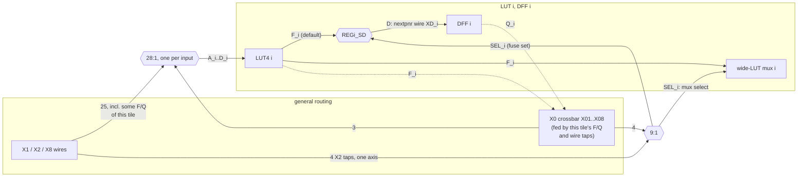
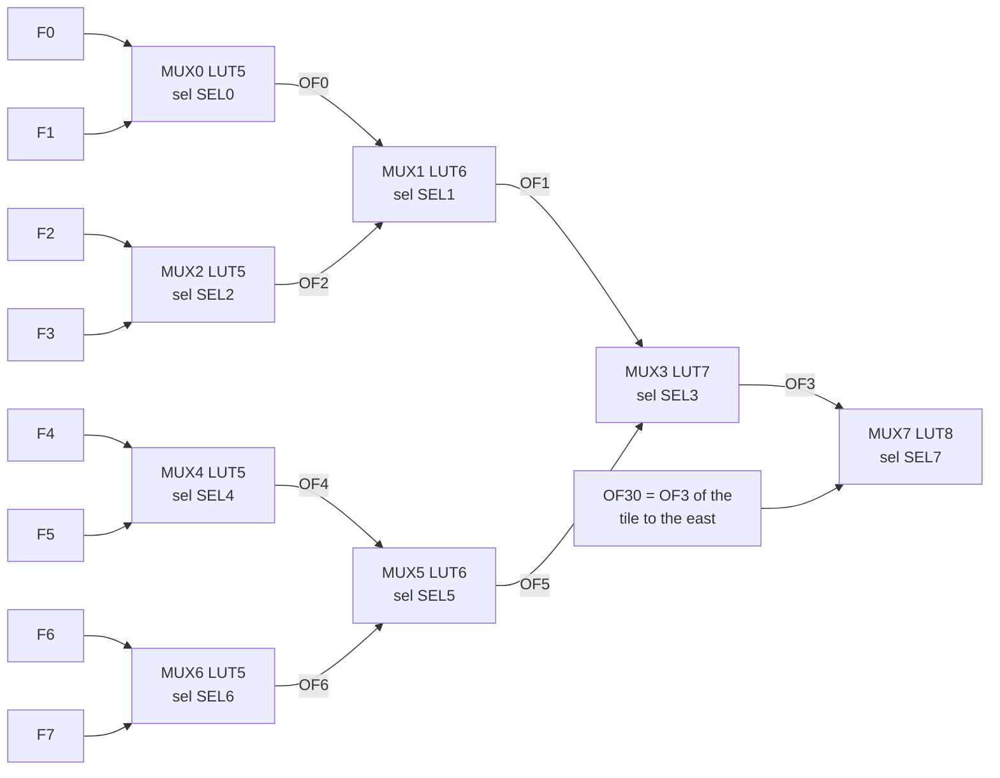

# Logic tile: LUTs, flip-flops, wide-LUT muxes and SEL

How the cells inside a Gowin logic tile connect, as Apicula's chipdb and nextpnr's
`gowin_arch_gen.py` describe them. Source counts are read from the chipdb of
GW1N-9C, GW2A-18C and GW5A-25A (tile R10C10). The three devices agree except for
SEL7 on GW5A-25A, which has 6 extra long-wire branch sources.

A logic tile has 8 LUT4s (0–7), 6 DFFs (0–5; 8 on devices with `HAS_DFF67`, such as
GW5A) and 6 ALUs on LUTs 0–5. The wide-LUT muxes combine the LUTs into LUT5 to LUT8.

## One LUT/DFF pair

- Each LUT input (A_i..D_i) has its own 28:1 routing mux. On LUT0, 3 of the 28
  sources are X0 wires.
- SEL_i is the output of a 9:1 routing mux. Its usual job is to select the wide-LUT
  mux with the same index.
- The DFF's D comes from a 2:1 in front of the DFF. By default it takes F_i, the
  output of its own LUT. With fuse `REGi_SD` set it takes SEL_i instead, so the DFF
  holds a value unrelated to the LUT and the LUT's F stays free for other logic.
  This reading comes from `gowin_unpack`, which decodes `REG{idx % 2}_SD` as
  "D from SEL{idx}" (`gowin_unpack.py`, DFF handling). It was not checked against
  vendor bitstreams here.
- nextpnr models the 2:1 output as wire `XD_i`. Upstream only has the pip F_i→XD_i,
  so a DFF whose D is not its own LUT's output gets a pass-through LUT after
  placement (`create_passthrough_luts`). [#505](https://github.com/YosysHQ/apicula/pull/505)
  and its nextpnr part add SEL_i→XD_i, which `gowin_pack` turns into `REGi_SD`.
- SEL_i and DFF i share the wire. A DFF fed from SEL_i rules out the wide-LUT mux
  with the same index.

## SEL sources

SEL has 9 sources against 28 on a LUT input, and the X2 taps come from one axis only.
An FF whose D comes through SEL therefore has far fewer ways in than one fed through
a pass-through LUT.

| SEL | X0 | X2 taps | other |
|---|---|---|---|
| SEL0, SEL2, SEL4, SEL6 | X05–X08 | E261, E262, W261, W262 | VCC |
| SEL1, SEL5 | X01–X04 | N261, N262, S261, S262 | VCC |
| SEL3 | X01, X02, X04 | E241, E242, N241, N242 | VCC |
| SEL7 | X01, X03, X04 | S241, S242, W241, W242 | VCC; GW5A-25A also LB01, LB11, LB21, LB51, LB61, LB71 |

## Wide-LUT mux tree

Mux i is selected by SEL_i, the same wire as DFF i's alternative D input.
